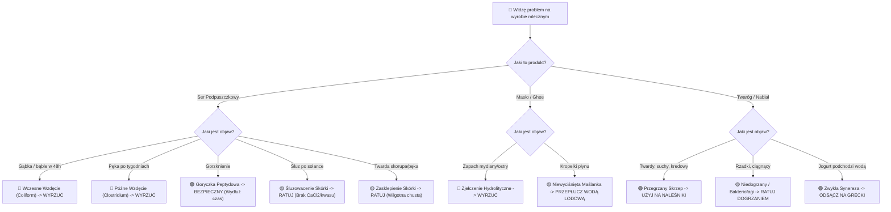

# **SEROWAR — Podręczny Przewodnik Terenowy i Baza Wiedzy (In-App Field Guide)**

> **Rola:** Principal Technical Writer, Craft Domain Researcher & In-App Knowledge Base Architect  
> **Projekt:** SEROWAR (Rzemieślnicze Przetwórstwo Mleka) | `com.apps4brew.serowar`  
> **Data wydania:** 17.10.2026  
> **Standard:** Format Offline < 2MB | Zasada 90 Sekund w Terenie | Potwierdzenie w min. 2 Źródłach Naukowych  
> **Powiązania:** [`docs/scope-contract.md`](file:///C:/Users/lukas/Documents/antigravity/calm-planck/docs/scope-contract.md), [`docs/brd/C1_Nauka_Szkola_Serowarstwa_i_Fermentacji.md`](file:///C:/Users/lukas/Documents/antigravity/calm-planck/docs/brd/C1_Nauka_Szkola_Serowarstwa_i_Fermentacji.md)

---

## 1. Szkoła Mleczarstwa i Koagulacji (Lekcje Terenowe 1–7)

Każda lekcja została skondensowana do $\le 250$ słów z ramką „W pigułce” na samym początku, aby rzemieślnik w kuchni mógł w 90 sekund zrozumieć zachodzący proces bez przedzierania się przez podręczniki akademickie.

### Lekcja 1: Biochemia Kazeiny i Cięcie Skrzepu
> **W pigułce:** Podpuszczka (chymozyna) działa jak nożyczki: odcina ochronny ogonek $\kappa$-kazeiny, co sprawia, że micele białkowe przestają się odpychać i łączą w stabilną siatkę żelu.
* **Dlaczego mleko płynne staje się ciałem stałym:** Cząsteczki kazeiny unoszą się w mleku w postaci mikroskopijnych kulek (miceli). Ich zewnętrzna warstwa ($\kappa$-kazeina) ma ładunek ujemny i odpycha inne micele jak magnesy o tych samych biegunach.
* **Moment zadania podpuszczki:** Chymozyna precyzyjnie przecina wiązanie peptydowe Phe105-Met106. Gdy 85% ogonków zostanie odciętych, micele tracą ładunek i pod wpływem jonów wapnia łączą się w skrzep.
* **Złota reguła polowa:** Nigdy nie ruszaj garnka podczas koagulacji! Każde wstrząśnięcie w fazie żelowania trwale niszczy strukturę mostków białkowych i powoduje ucieczkę tłuszczu do serwatki.
* **Źródła:** *Fox et al., "Cheese: Chemistry, Physics and Microbiology", Vol 1; IDF Standard 157.*

---

### Lekcja 2: Rola Wapnia Koloidalnego ($Ca^{2+}$) i Ratunek Mleka Sklepowego
> **W pigułce:** Pasteryzacja wytrąca rozpuszczalny wapń do formy nierozpuszczalnej. Dodatek 0.1–0.4 g $CaCl_2$ na litr przywraca mostki wapniowe i umożliwia ścięcie mleka sklepowego.
* **Problem pasteryzacji:** Ogrzanie mleka powyżej 65°C powoduje przejście jonów $Ca^{2+}$ w nierozpuszczalny fosforan trójwapniowy. Bez wolnego wapnia micele po odcięciu przez podpuszczkę nie potrafią się ze sobą sczepić (skrzep jest wiotki lub nie powstaje wcale).
* **Mleko UHT to granica absolutna:** Mleko UHT (ogrzane do 135–150°C) ulega całkowitej denaturacji $\beta$-laktoglobuliny, która trwale oblepia kazeinę. Żadna ilość chlorku wapnia ani podpuszczki go nie zetnie.
* **Dawkowanie polowe:** Rozpuść odważony $CaCl_2$ w 50 ml chłodnej wody niechlorowanej i wymieszaj z mlekiem przed podgrzaniem do temperatury zaprawiania.
* **Źródła:** *Lucey & Fox, "Rennet Coagulation of Milk"; Walstra et al., "Dairy Technology".*

---

### Lekcja 3: Mezofile vs Termofile — Wybór Bakterii Starterowych
> **W pigułce:** Mezofile pracują w 20–32°C (Gouda, Cheddar, Twaróg); termofile potrzebują 38–45°C (Mozzarella, Parmezan, Jogurt). Pomylenie temperatur oznacza śmierć kultur.
* **Bakterie mezofilne (typ O i LD):** *Lactococcus lactis* i *Leuconostoc*. Wytwarzają kwas mlekowy w łagodnych temperaturach. Szczepy diacetylis fermentują cytryniany, tworząc maślany aromat i drobne oczka.
* **Bakterie termofilne (typ T):** *Streptococcus thermophilus* i *Lactobacillus delbrueckii subsp. bulgaricus*. Odporne na wysokie dogrzewanie skrzepu (nawet do 55°C w serach alpejskich).
* **Wskazówka praktyczna:** Zawsze uwadniaj liofilizat DVI przez 20–30 minut na powierzchni ciepłego mleka przed energicznym wymieszaniem.
* **Źródła:** *Chr. Hansen Dairy Culture Manual; Cogan & Hill, "Applied Dairy Microbiology".*

---

### Lekcja 4: Fizyka Synerezy — Jak Ziarno Oddaje Serwatkę
> **W pigułce:** Im drobniej pokroisz skrzep i im wyżej go dogrzejesz, tym twardszy i suchszy ser otrzymasz. Kukurydza to ser miękki, ziarno grochu to ser twardy.
* **Mechanizm synerezy:** Skurcz siatki kazeinowej wyciska uwięzioną wewnątrz serwatkę. Zjawisko przyspieszają trzy czynniki: kwasowość (spadek pH), temperatura oraz cięcie mechaniczne.
* **Rampa temperaturowa (max 1°C na 2 minuty):** Zbyt szybkie podgrzanie powoduje „zeszklenie” powierzchni ziarna — zewnętrzna warstwa tworzy nieprzepuszczalną skorupkę, więżąc serwatkę w środku, co prowadzi do późniejszego kwaśnienia i pękania sera.
* **Test ściśnięcia dłonią:** Ściśnij garść ziarna w serwatce — powinno zbić się w bryłkę, która po lekkim dotknięciu palcem łatwo rozsypuje się z powrotem na pojedyncze ziarenka.
* **Źródła:** *Kosikowski & Mistry, "Cheese and Fermented Milk Foods"; Dejmek & Walstra, "Syneresis of Curd".*

---

### Lekcja 5: Ekologia Dojrzewalni (Affinage) i Pielęgnacja Skórki
> **W pigułce:** Dojrzewanie to kontrolowana sukcesja biologiczna: najpierw drożdże odkwaszają skórkę do pH 5.8, a dopiero potem wchodzi czerwona maź *B. linens* lub biały aksamit *Penicillium*.
* **Dlaczego ser potrzebuje soli i wilgoci:** Sól konserwuje zewnętrzną warstwę, wyciąga nadmiar wilgoci i tworzy barierę dla pleśni dzikich.
* **Mikroklimat:** Wilgotność 85–92% RH i temperatura 11–13°C to złoty standard. Zbyt sucho (RH < 80%) = zasklepienie i pękanie; zbyt wilgotno (RH > 95%) = rozwój czarnych pleśni *Mucor*.
* **Czystość desek:** Używaj surowego drewna bukowego lub świerkowego — jego naturalny mikrobiom chroni ser przed patogenami lepiej niż plastikowe kratki.
* **Źródła:** *Berdagué et al., "Microbiology of Cheese Rinds"; USDA Guidelines for Small-Scale Cheese Aging.*

---

### Lekcja 6: Masielnictwo — Inwersja Faz i Płukanie Lodowe
> **W pigułce:** Zmaślanie to odwrócenie emulsji tłuszcz-w-wodzie (śmietanka) na woda-w-tłuszczu (masło). Temperatura śmietanki musi wynosić ściśle 10–13°C.
* **Dlaczego temperatura jest krytyczna:** W 10–13°C tłuszcz mleczny znajduje się w stanie półstałym (częściowo płynny, częściowo skrystalizowany). Pozwala to pęcherzykom powietrza rozbijać otoczki MFGM i sklejać kryształy w ziarna masła. Zbyt ciepła śmietanka (>16°C) da maź zamiast masła; zbyt zimna (<8°C) nie zmaśli się wcale.
* **Płukanie lodowatą wodą (<6°C):** Płucz ziarno masła 3-krotnie, aż woda będzie idealnie przejrzysta. Pozostawiona maślanka zepsuje masło w 5 dni.
* **Źródła:** *Tetra Pak Dairy Processing Handbook; Codex Standard for Butter (CXS 279-1971).*

---

### Lekcja 7: Zamknięty Obieg Serwatki — Ricotta i Norweski Brunost
> **W pigułce:** Serwatka zawiera 50% składników odżywczych mleka. Ogrzanie jej do 88°C daje delikatną Ricottę, a długie odparowanie w 102°C karmelizuje laktozę w brunatny Brunost.
* **Ricotta:** Bazuje na albuminach i globulinach. Białka te nie reagują na podpuszczkę, ale ścinają się pod wpływem wysokiej temperatury (85–90°C) i lekkiego zakwaszenia (pH 5.8–6.0).
* **Brunost / Mysost:** Tradycyjny norweski ser serwatkowy. Wielogodzinne gotowanie odparowuje wodę z 94% do 20%, a reakcja Maillarda (karmelizacja laktozy z aminokwasami) nadaje masie toffi barwę i słodki smak.
* **Źródła:** *IDF Bulletin 389: Whey Processing; Røstad et al., "Traditional Norwegian Whey Cheese (Brunost)".*

---

## 2. Kompas Diagnostyczny (Cheese Doctor & Dairy Doctor)

System triage'u wizualnego od objawu do instrukcji ratunkowej w 3 krokach.



### Macierz Rozwiązywania Problemów (Tabela Triage)

| Kod Wady | Nazwa i Objaw Wizualny | Przyczyna Biologiczna / Fizyczna | Werdykt | Instrukcja Ratunkowa w 3 Krokach |
| :--- | :--- | :--- | :---: | :--- |
| **D-01** | **Wczesne Wzdęcie (Gąbka)**<br>Drobne dziurki jak w gąbce w 24–48h, wybrzuszenie, zapach fekalny/drożdżowy. | Zakażenie bakteriami z grupy Coli (*E. coli*, *Enterobacter*) produkującymi gazy $H_2$ i $CO_2$. | 🔴 **WYRZUĆ BEZWZGLĘDNIE** | 1. Wyrzuć ser do odpadów (nie podawaj zwierzętom).<br>2. Wyszoruj i wygotuj formy, chusty i prasę we wrzątku (min. 15 min).<br>3. Pasteryzuj mleko przy kolejnym warzeniu (63°C/30 min). |
| **D-02** | **Późne Wzdęcie Maślanowe**<br>Pękanie i puchnięcie krążka po 4–10 tygodniach, zapach rzygów i zjełczałego masła. | Przetrwalniki *Clostridium tyrobutyricum* z kiszonki; fermentacja kwasu masłowego. | 🔴 **WYRZUĆ BEZWZGLĘDNIE** | 1. Wada przenika cały miąższ — nie odkrawaj pęknięć.<br>2. Wyrzuć krążek do śmieci zmieszanych.<br>3. Półkę przemyj 10% roztworem sody kalcynowanej i naświetl UV. |
| **D-03** | **Goryczka Kazeinowa**<br>Wygląd normalny, nieprzyjemny gorzki posmak zalegający na tylnej części języka. | Akumulacja gorzkich peptydów hydrofobowych przez nadmiar podpuszczki lub mało soli ($S/M < 4\%$). | 🟢 **BEZPIECZNE** | 1. Ser jest w 100% zdatny do spożycia.<br>2. Wydłuż leżakowanie o 6 tygodni w 13°C (peptydazy mogą rozłożyć goryczkę).<br>3. Użyj do zapiekanek lub pizzy (tłuszcz maskuje gorzki smak). |
| **D-04** | **Śluzowacenie Skórki w Solance**<br>Powierzchnia krążka po kąpieli jest śliska, mydlasta i zmywa się pod palcami. | Wypłukanie wapnia ze skórki z powodu braku $CaCl_2$ w solance lub zbyt wysokiego pH ($>5.6$). | 🟡 **WYMAGA INTERWENCJI** | 1. Wyjmij ser i osusz czystym ręcznikiem bawełnianym.<br>2. Dodaj do solanki 0.2% $CaCl_2$ i zakwasz serwatką/kwasem do pH 5.2–5.4.<br>3. Obsyp ser cienką warstwą suchej soli i pozostaw do obeschnięcia na 24h. |
| **D-05** | **Zasklepienie Skórki (Case Hardening)**<br>Zewnętrzna skorupa twarda jak drewno, a wnętrze ciapowate, wilgotne i wyciekające. | Zbyt niska wilgotność (RH < 75%) lub przeciąg w jaskini. Woda odparowała szybciej niż dyfuzja. | 🟡 **WYMAGA INTERWENCJI** | 1. Zawiń krążek w wyparzoną chustę zwilżoną 3% solanką na 48 godzin.<br>2. Umieść krążek w zamkniętym pojemniku z wilgotnością 90–92% RH.<br>3. Obracaj codziennie, aż wilgoć w krążku się wyrówna. |
| **D-06** | **Koty / Kłaczki Pleśni Dzikiej (Mucor)**<br>Wysokie, szare lub czarne „włosy” na powierzchni skórki sera w piwnicy. | Pleśnie dzikie *Mucor miehei* lub *Rhizopus* rozwijające się przy zbyt wysokiej wilgotności (RH > 95%). | 🟡 **WYMAGA INTERWENCJI** | 1. Wyszczotkuj energicznie suchą, twardą szczoteczką z naturalnego włosia.<br>2. Przemyj skórkę nasyconą solanką (20%) z dodatkiem odrobiny octu jabłkowego.<br>3. Obniż wilgotność w dojrzewalni do 85% i zwiększ delikatną cyrkulację. |
| **D-07** | **Zjełczenie Masła (Hydrolityczne)**<br>Masło ma ostry, piekący, mydlany posmak i zapach starego łoju. | Rozkład trójglicerydów do wolnych kwasów tłuszczowych przez lipazy mleka niepasteryzowanego. | 🔴 **WYRZUĆ BEZWZGLĘDNIE** | 1. Masło nie nadaje się do jedzenia na surowo.<br>2. W przypadku lekkiego zapachu można przetopić na ghee (wysoka temperatura neutralizuje część kwasów).<br>3. Przy kolejnej partii spasteryzuj śmietankę w 75°C przez 15 sekund, by unieczynnić lipazy. |
| **D-08** | **Kropelkowanie Masła (Płaczące Masło)**<br>Na przekroju osełki widoczne są duże krople płynu, maślanka wycieka z papieru. | Niedostateczne wygniecenie masła na desce serowarskiej; zbyt duże kropelki fazy wodnej. | 🟡 **WYMAGA INTERWENCJI** | 1. Schłodź masło w wodzie lodowej (<6°C).<br>2. Ugniataj drewnianą łopatką na zwilżonej desce, aż przestanie oddawać płyn.<br>3. Prawidłowo wyrobione masło ma jednolicie suchy, lśniący przekrój. |
| **D-09** | **Twaróg Twardy, Suchy i Kredowy**<br>Ziarenka twarogu są sztywne jak grysik, nie dają się rozsmarować na chlebie. | Przegrzanie skrzepu powyżej 44–46°C w trakcie dogrzewania klinka. | 🟢 **BEZPIECZNE** | 1. Twaróg jest w 100% zdatny do spożycia.<br>2. Zblenduj go z dodatkiem gęstej śmietanki 18% lub jogurtu na puszysty gzik.<br>3. Przy kolejnym nastawie nie przekraczaj temperatury 38–40°C przy dogrzewaniu. |
| **D-10** | **Wydzielanie Serwatki w Jogurcie (Synereza)**<br>Na powierzchni jogurtu stoi 1–2 cm przezroczysto-żółtego płynu. | Naruszenie struktury żelu (wstrząśnięcie słoikiem w trakcie inkubacji) lub niska sucha masa mleka. | 🟢 **BEZPIECZNE** | 1. Zjawisko w 100% naturalne i bezpieczne — serwatka jest pełna białek i minerałów.<br>2. Zamieszaj łyżeczką, by przywrócić jednolitą konsystencję, LUB:<br>3. Wylej na gęste sitko wyłożone gazą na 2 godziny — otrzymasz gęsty jogurt grecki/labneh. |

---

## 3. Tabele Bezpieczeństwa Biologicznego i Przeliczniki (Zasada 2 Źródeł)

Wszystkie dane poniżej zostały zweryfikowane w oparciu o min. 2 oficjalne standardy międzynarodowe: **Codex Alimentarius**, **IDF (International Dairy Federation)** oraz **USDA Food Safety Guidelines**.

### Tabela 1: Reżimy Pasteryzacji Mleka i Denaturacji Białek
| Metoda Obróbki | Temperatura | Czas | Cel Technologiczny i Mikrobiologiczny | Status Kazeiny i Serwatki |
| :--- | :---: | :---: | :--- | :--- |
| **LTLT (Niska długa)** | $63.0^\circ C - 65.0^\circ C$ | $30\text{ min}$ | Zniszczenie *Mycobacterium*, *Coxiella*, *Listeria*, *Salmonella*. Minimalny wpływ na smak. | Kazeina nienaruszona. Wymaga lekkiego dodatku 0.1 g/L $CaCl_2$. Złoty standard serowarstwa zagrodowego. |
| **HTST (Wysoka krótka)** | $72.0^\circ C - 75.0^\circ C$ | $15\text{ s}$ | Standard mleczarni przemysłowych dla mleka świeżego mikrofiltrowanego. | Początek denaturacji $\beta$-laktoglobuliny (5–10%). Wymaga 0.2–0.3 g/L $CaCl_2$. |
| **Pasteryzacja Jogurtowa**| $85.0^\circ C - 90.0^\circ C$ | $5 - 10\text{ min}$ | Celowa, głęboka denaturacja białek serwatkowych w celu zapobiegania synerezie w jogurcie. | Białka serwatkowe wiążą się z kazeiną. **Bezwzględny zakaz stosowania do sera podpuszczkowego!** |
| **UHT (Ultra High Temp)** | $135.0^\circ C - 145.0^\circ C$ | $2 - 4\text{ s}$ | Jałowość handlowa, przechowywanie w kartonie przez 6 miesięcy. | Całkowita destrukcja miceli. **Niezdatne do wyrobu sera.** |

*Źródła: FDA Grade "A" Pasteurized Milk Ordinance (PMO); IDF Bulletin 496/2019.*

---

### Tabela 2: Nasycona Solanka Serowarska (Saturated Brine Table)
Parametry przygotowania 10 litrów profesjonalnej solanki serowarskiej:
* **Woda przegotowana:** 8.0 litrów
* **Czysta sól kamienna niejodowana:** 2.2 kg (docelowe stężenie $\sim 20–22\%$ wagowo)
* **Chlorek wapnia ($CaCl_2$ 33%):** 40 ml (stężenie jonów $Ca^{2+}$ zapobiegające wyciąganiu wapnia z sera)
* **Kwas mlekowy lub serwatka z nastawu:** do uzyskania $pH = 5.2 - 5.4$

| Stężenie Wagowe (% NaCl) | Gęstość przy 15°C ($g/cm^3$) | Stopnie Baumé (°Bé) | Skala Salometru (°Sal) | Czas Kąpieli na 1 kg sera (Typ Gouda) |
| :---: | :---: | :---: | :---: | :---: |
| **16.0%** | 1.118 | 15.3 | 60° | 16–18 godzin |
| **18.0%** | 1.134 | 17.1 | 68° | 12–14 godzin |
| **20.0% (Optimum)** | **1.151** | **19.0** | **76°** | **10–12 godzin** |
| **22.0% (Maksimum)**| **1.168** | **20.8** | **83°** | **8–10 godzin** |
| **26.4% (Nasycenie)**| 1.204 | 24.6 | 100° | Nie stosować (za gwałtowny skurcz skórki) |

*Źródła: Scott, "Cheesemaking Practice"; Guinee & Fox, "Salt in Cheese: Physical, Chemical and Biological Aspects".*

---

### Tabela 3: Psychrometria Komory Dojrzewalniczej (Cave Microclimate)
| Typ Sera | Optymalna Temp. | Wilgotność RH | Docelowy VPD (Prężność Pary) | Ryzyko przy odchyleniu |
| :--- | :---: | :---: | :---: | :--- |
| **Twarde (Alpejskie, Cheddar)** | $10 - 13^\circ C$ | $82 - 85\%$ | $0.18 - 0.24\text{ kPa}$ | RH < 80%: pękanie krążka; RH > 90%: brak formowania suchej skórki. |
| **Półtwarde (Gouda, Tilsit)** | $12 - 14^\circ C$ | $86 - 90\%$ | $0.14 - 0.18\text{ kPa}$ | RH < 84%: twarda skorupa; RH > 92%: pleśń dzika. |
| **Maziowe (Brevibacterium)** | $13 - 15^\circ C$ | $92 - 96\%$ | $0.06 - 0.10\text{ kPa}$ | RH < 90%: wyschnięcie i obumarcie mazi maziowej. |
| **Białe Pleśniowe (Camembert)**| $11 - 13^\circ C$ | $90 - 94\%$ | $0.08 - 0.12\text{ kPa}$ | RH < 88%: słaby, łysy porost grzybni; RH > 96%: śluzowacenie. |
| **Niebieskie (Roquefort/Stilton)**| $10 - 12^\circ C$ | $90 - 95\%$ | $0.07 - 0.11\text{ kPa}$ | Brak nakłuwania: brak tlenu w kanalikach i brak zarodnikowania. |

*Źródła: IDF Bulletin on Cheese Ripening Rooms; ASHRAE Handbook: Refrigeration (Dairy Products).*

---

## 4. Słownik Rzemieślnika (Craft Glossary — 25 Pojęć)

1. **Affinage:** Sztuka pielęgnacji i dojrzewania sera w jaskini lub chłodni dojrzewalniczej (obracanie, zmywanie, maziowanie).
2. **Albuminy i Globuliny:** Białka serwatkowe o wysokiej wartości biologicznej, które nie koagulują pod wpływem podpuszczki, lecz wymagają wysokiej temperatury ($>85^\circ C$).
3. **Brevibacterium linens:** Pożyteczne bakterie tlenowe tworzące pomarańczowo-czerwoną, lepką i aromatyczną maź na serach takich jak Munster czy Limburger.
4. **Brunost (Mysost):** Tradycyjny norweski karmelizowany ser serwatkowy o barwie i smaku toffi, wytwarzany przez wielogodzinne odparowanie wody z serwatki.
5. **Cheddaring:** Specjalistyczny proces krojenia skrzepu w bloki, układania ich w stosy i obracania w cieple (35°C), prowadzący do demineralizacji kazeiny i nadania charakterystycznej włóknistej struktury.
6. **Chymozyna:** Główny enzym podpuszczki naturalnej lub mikrobiologicznej przecinający $\kappa$-kazeinę i wywołujący koagulację.
7. **Clean Break (Czysty Złom):** Moment, w którym nacięty nożem skrzep pęka gładko jak porcelana, odsłaniając przezroczystą, żółtawo-zielonkawą serwatkę bez pływających kłaczków białka.
8. **Cultured Butter (Masło Ukwaszone):** Tradycyjne masło zmaślane ze śmietanki poddanej wstępnej fermentacji mezofilnej, cechujące się głębszym aromatem diacetylu i dłuższą trwałością.
9. **Curd Washing (Przemywanie Gęstwy):** Zlanie części serwatki i zastąpienie jej gorącą wodą w celu wypłukania nadmiaru laktozy (technika stosowana w serach Gouda i Edam, dająca łagodny, nieskwaśniały smak).
10. **Diacetyl:** Naturalny maślany związek aromatyczny wytwarzany ze szlaku cytrynianowego przez bakterie *Lactococcus lactis subsp. diacetylactis*.
11. **DVI / DVS (Direct Vat Inoculation):** Liofilizowane, skoncentrowane kultury bakterii zadawane bezpośrednio do kotła bez konieczności namnażania matki w sterylnym mleku.
12. **Flocculation Point ($t_f$):** Punkt flokulacji — czas w minutach od zadania podpuszczki do momentu, w którym lekka miseczka obracająca się na powierzchni mleka nagle staje w miejscu.
13. **Flocculation Multiplier ($M$):** Współczynnik mnożnikowy (od 2.0x dla serów twardych do 5.0x dla Camemberta), przez który mnoży się $t_f$, by wyznaczyć idealny moment krojenia skrzepu ($t_{cut} = t_f \times M$).
14. **Ghee:** Czysty bezwodny tłuszcz mleczny ($>99.8\%$) otrzymywany przez powolne wytapianie masła, całkowite odparowanie wody i skarmelizowanie resztek kazeiny, cechujący się punktem dymienia $250^\circ C$.
15. **IMCU (International Milk Clotting Units):** Międzynarodowa, ustandaryzowana jednostka siły koagulującej podpuszczki według normy IDF 157.
16. **Inwersja Emulsji:** Zmiana fazy ciągłej ze śmietanki (kropelki tłuszczu zawieszone w wodzie O/W) na masło (kropelki wody zawieszone w tłuszczu W/O).
17. **Kazeina:** Główne białko mleka (ok. 80% frakcji białkowej), zorganizowane w micele połączone mostkami fosforanowo-wapniowymi.
18. **Klinek:** Trójkątna chusta serowarska ze stożkowym szpicem, służąca do grawitacyjnego odsączania i formowania tradycyjnego polskiego twarogu wiejskiego.
19. **Labneh:** Bliskowschodni kremowy ser świeży otrzymywany przez odsączenie serwatki z jogurtu naturalnego w woreczku bawełnianym, często formowany w kulki w oliwie ziołowej.
20. **MFGM (Milk Fat Globule Membrane):** Trójwarstwowa otoczka kuleczek tłuszczowych bogata w fosfolipidy, która chroni tłuszcz przed lipolizą; rozbijana mechanicznie w procesie zmaślania.
21. **Penicillium candidum / camemberti:** Szlachetna pleśń serowarska tworząca białą, puszystą, aksamitną skórkę na serach typu Brie i Camembert.
22. **Penicillium roqueforti:** Szlachetna niebiesko-zielona pleśń przerastająca wnętrze serów z niebieskim porostem (Gorgonzola, Roquefort), wymagająca tlenu wprowadzanego przez nakłuwanie igłami.
23. **Punkt Izoelektryczny ($pI = 4.6$):** Wartość pH, przy której ładunek elektryczny cząsteczek kazeiny spada do zera, wywołując kwasową koagulację mleka (fundament powstawania twarogu).
24. **Synereza:** Zjawisko kurczenia się żelu kazeinowego i aktywnego wyciskania serwatki pod wpływem kwasu, ciepła i cięcia mechanicznego.
25. **VPD (Vapour Pressure Deficit):** Deficyt prężności pary wodnej (wyrażany w kPa) określający rzeczywistą siłę suszącą powietrza w dojrzewalni; jedyny niezawodny wskaźnik zapobiegający pękaniu skórki sera.

---

## 5. Empatyczne Mikro-copy i Podpowiedzi w UI

Poniższe teksty stanowią oficjalny standard komunikatów w interfejsie aplikacji SEROWAR:

### 5.1 Dymki Pomocy `(?)` przy Polach Kalkulatora
* **Pole: Chlorek Wapnia ($CaCl_2$):**  
  *„Mleko pasteryzowane traci w wysokiej temperaturze wolne jony wapnia, co osłabia skrzep. Dodatek $CaCl_2$ (0.1–0.3 g na litr) przywraca mostki wapniowe i sprawia, że skrzep tnie się równo jak galaretka. Jeśli używasz mleka prosto z udoju, pole możesz zostawić puste.”*
* **Pole: Siła Podpuszczki (IMCU):**  
  *„IMCU to międzynarodowa miara mocy enzymu. Standardowa podpuszczka w płynie ma zwykle 200–220 IMCU/ml, a granulaty mikrobiologiczne nawet 2000 IMCU/g. Sprawdź etykietę na buteleczce — aplikacja sama przeliczy krople na litr.”*
* **Pole: Mnożnik Flokulacji ($M$):**  
  *„Zamiast zgadywać czas cięcia na zegarku, połóż na powierzchni mleka lekką plastikową miseczkę i zakręć nią. Gdy miseczka nagle stanie w miejscu (skrzep złapał wiązanie), zatrzymaj stoper. Zmierzony czas pomnóż przez współczynnik stylu: 2.5x dla Goudy, 4x dla Camemberta. Otrzymasz idealną wilgotność sera!”*
* **Pole: Nacisk Prasy ($kg/cm^2$):**  
  *„Ciężar na dźwigni to nie to samo co nacisk na serze! Duża forma o średnicy 20 cm potrzebuje 4 razy większego ciężaru niż mała foremka 10 cm, aby uzyskać ten sam stopień sprasowania. Nasz kalkulator automatycznie przelicza pole powierzchni.”*

### 5.2 Empatyczne Komunikaty Błędów Walidacji
* **Próba wyboru mleka UHT:**  
  *„Niestety, mleko UHT nie nadaje się do wyrobu sera. Zostało podgrzane do ponad 135°C, co trwale zniszczyło strukturę białek i uniemożliwia ścięcie podpuszczką. Aby Twój ser się udał, wybierz w sklepie mleko „świeże mikrofiltrowane” pasteryzowane w niskiej temperaturze lub mleko surowe ze sprawdzonego gospodarstwa.”*
* **Zbyt wysoka temperatura zmaślania śmietanki ($>16^\circ C$):**  
  *„Śmietanka ma 18°C — w tej temperaturze tłuszcz jest zbyt miękki i zamiast ziaren masła otrzymasz gęstą emulsję lub maź. Schłodź śmietankę w lodówce do 11–12°C. Zapewni to perfekcyjne, chrupiące ziarna masła w 15 minut!”*
* **Zbyt niska solanka ($<15\%$):**  
  *„Stężenie solanki wynosi 12%. Tak słaby roztwór nie zakonserwuje skórki i może spowodować śluzowacenie powierzchni krążka. Zalecamy min. 18–20% soli dla bezpiecznego leżakowania sera.”*

### 5.3 Puste Stany Ekranów (Empty States)
* **Zakładka Dojrzewalnia (Cave Log):**  
  *„Twoja dojrzewalnia jest jeszcze pusta! Żaden krążek nie leżakuje na bukowych deskach. Nastaw swój pierwszy ser podpuszczkowy w zakładce „Serowar” lub dodaj krążek, który już dojrzewa w Twojej piwniczce.”*
* **Zakładka Spiżarnia:**  
  *„Twoja spiżarnia surowców czeka na uzupełnienie. Wpisz posiadane mleko, kulturę starterową i podpuszczkę, a aplikacja będzie automatycznie odliczać zużyte składniki po każdym udanym warzeniu.”*

---

## 6. Rzemieślnicze Release Notes (App Store / TestFlight)

### Wersja 1.0 (MVP) — Narodziny Serowara
```
Witaj w pierwszym wydaniu aplikacji SEROWAR — Twoim kieszonkowym asystencie rzemieślniczego przetwórstwa mleka!

Co nowego w wersji 1.0:
🧀 Precyzyjny Kalkulator Serowara: Złap idealny moment cięcia skrzepu dzięki interaktywnemu stoperowi flokulacji Berridge'a. Koniec z gumowatym lub przesuszonym ziarnem!
🧈 Kuchnia Mleczarska bez Odpadów: Formuj tradycyjne twarogi klinkowe w punkcie pH 4.6, zmaślaj aksamitne masło cultured butter i wytapiaj złociste ghee.
🔄 Zamknięty Obieg Serwatki: Nie wylewaj serwatki do zlewu — wyczaruj delikatną Ricottę lub słodki norweski Brunost.
🏔️ Dojrzewalnia (Cave Log): Rejestruj krążki, śledź ubytek wagi (% shrinkage) i pilnuj harmonogramu przemywania maziowego.
📖 Przewodnik Terenowy: Zintegrowana baza wiedzy offline, tabele pasteryzacji i Cheese Doctor gotowy do pomocy w kuchni.

100% offline, zero reklam, bez wymogu logowania. Udanych nastawów!
```
