# **SEROWAR — Kontrakt Zakresu Produktowego (Scope Contract v1.0)**

> **Rola:** Head of Product, Principal Product Owner & Scope Gatekeeper  
> **Projekt:** SEROWAR (Rzemieślnicze Przetwórstwo Mleka) | `com.apps4brew.serowar`  
> **Data zamrożenia zakresu:** 17.10.2026  
> **Status:** **ZAMROŻONY (FROZEN MVP v1.0)**  
> **Powiązania:** [`docs/brd/`](file:///C:/Users/lukas/Documents/antigravity/calm-planck/docs/brd/), [`docs/audyt-monetyzacji.md`](file:///C:/Users/lukas/Documents/antigravity/calm-planck/docs/audyt-monetyzacji.md), [`docs/32-wzorce-interakcji.md`](file:///C:/Users/lukas/Documents/antigravity/calm-planck/docs/32-wzorce-interakcji.md), [`docs/ux/blueprint-ekranow.md`](file:///C:/Users/lukas/Documents/antigravity/calm-planck/docs/ux/blueprint-ekranow.md)

---

## 1. Definicja Zadania Głównego (The Core Job & Single-Job Primacy)

### 1.1 Misja Produktu
**SEROWAR** to bezkompromisowy, precyzyjny asystent kieszonkowy dla rzemieślników domowych i zagrodowych, przekształcający surowe lub mikrofiltrowane mleko w perfekcyjne sery podpuszczkowe, tradycyjne twarogi klinkowe, masło, napoje probiotyczne i produkty z odzysku serwatki.

### 1.2 The Core Job (JTBD)
> *„Gdy mam w kuchni lub serowarni 10–50 litrów świeżego mleka i mokre dłonie („ręce w serwatce”), chcę w 3 dotknięciach obliczyć dawkę podpuszczki IMCU, precyzyjnie złapać moment cięcia skrzepu stoperem flokulacji i zarejestrować leżakujący krążek w jaskini, aby żaden litr cennego mleka się nie zmarnował i aby powtórzyć idealny profil sera za 6 miesięcy.”*

---

## 2. Aksjomat Ekonomii AI ($0) i Zasada Słoika (Anti-Bloat Principle)

### 2.1 Aksjomat Zerowego Kosztu Kodu AI
Fakt, że agent sztucznej inteligencji potrafi wygenerować 500 linii kodu w 30 sekund za darmo ($0), **nie jest i nigdy nie będzie** argumentem za dodaniem funkcji do aplikacji.
* **Waluta, którą chronimy:** Uwaga, czas i obciążenie poznawcze (Cognitive Load) rzemieślnika przy garnku z mlekiem.
* **Kryterium cięcia:** Jeśli funkcja dodaje zbędny ekran, wymaga więcej niż 3 interakcji w warunkach kuchennych lub paraliżuje użytkownika akademicką teorią — zostaje bezlitośnie odrzucona.

### 2.2 Zasada Słoika (Słoik Anti-Bloat Principle)
Wzorując się na lekcji z projektu *Słoik*, wykluczamy encyklopedyczny przerost formy nad treścią:
1. **Silnik obliczeniowy w tle (`src/core/`):** Złożona biochemia (kinetyka kwaszenia, punkt izoelektryczny kazeiny pH 4.6, denaturacja białek serwatkowych w 85°C, równanie psychrometryczne punktu rosy) jest w 100% zaimplementowana pod maską i testowana rygorystycznymi wyroczniami prawdy.
2. **Interfejs polowy (UI):** Prosty, czysty, z dużymi polami dotykowymi ($\ge 48\times 48\text{ pt}$), predefiniowanymi wartościami domyślnymi i brakiem konieczności wpisywania danych z klawiatury podczas kluczowych faz obróbki skrzepu.
3. **Warstwa edukacyjna:** Pełne wykłady i tabele trafiają do dedykowanego modułu `Baza Wiedzy / Field Guide`, nie blokując ścieżki krytycznej nastawu.

---

## 3. Dekompozycja Rodziny Aplikacji (The Anti-Combine Decision)

### 3.1 Werdykt: Odrzucenie Kombajnu
Przetwórstwo mleczne i fermentacje roślinne (ogórki, kapusta, kimchi, kombucha, ocet) posiadają całkowicie odmienną dynamikę mikrobiologiczną, inny sprzęt i inne persony użytkowników:
* **SEROWAR (Aplikacja Rdzenna):** Skupienie w 100% na przetwórstwie mlecznym (mleko krowie, kozie, owcze, bawole).
* **SŁOIK (Aplikacja Satelicka / Spin-off):** Domowe kiszonki warzywne, fermentacje octowe i kombucha funkcjonują jako osobny, wyspecjalizowany produkt w portfolio Apps4Brew ze wspólnym standardem archiwum JSON.

### 3.2 Matryca Odzysku Komponentów z Portfolio (Portfolio Harvesting)
| Moduł / Wzorzec | Projekt źródłowy | Zastosowanie w SEROWAR |
| :--- | :--- | :--- |
| **Baza SQLite WAL & Migracje** | *Słoik* / *Napar* | 18 tabel relacyjnych, rotacja 10 kopii zapasowych, brak blokad przy zapisie |
| **Silnik proporcji surowców** | *Oczko* / *Napar* | Kalkulator mleka, kultur DVI, podpuszczki i dodatków w `src/core/` |
| **System logowania partii** | *Trening* | Kartoteka krążków Cave Log z harmonogramem serii czynności |
| **Resilient Background Timers** | *Organizer* | Stoper flokulacji i Live Activity odporne na uśpienie systemu iOS |
| **Lokalny StoreKit 2 & Paywall** | Standard Apps4Brew | Subskrypcje bez zewnętrznych SDK (RevenueCat free), plik `.storekit` |
| **Tarcza Odczytu Archiwum** | Zasada etyczna | Dożywotni darmowy dostęp do odczytu i eksportu własnych partii |

---

## 4. Bezlitosny Audyt Bloatu i Taksonomia Odrzuceń (Feature Kill List)

Wszystkie pomysły i wymagania spoza twardego rdzenia zostały skategoryzowane wg taksonomii bloatu:

| Funkcjonalność / Pomysł | Kategoria Bloatu | Przyczyna odrzucenia | Kompromis / Alternatywa |
| :--- | :--- | :--- | :--- |
| **Kiszonki warzywne, kombucha, octy** | `[BLOAT-COMBINE]` | Naruszenie tożsamości marki, rozmycie ASO, chaos w menu | Wydzielenie do dedykowanej aplikacji *Słoik* |
| **Chmura, logowanie, konta użytkowników** | `[BLOAT-SOCIAL]` | Złamanie etosu offline-first i prywatności Apps4Brew | 100% lokalna baza SQLite WAL z eksportem JSON |
| **Społecznościowy feed serowarów, polubienia** | `[BLOAT-SOCIAL]` | Zero WTP, rozproszenie uwagi, koszty moderacji i serwerów | Udostępnianie receptury offline przez kod QR |
| **Kwasowość miareczkowa (°Dornic, °SH, °Thörner) w głównym widoku** | `[BLOAT-LAB]` | Paraliż poznawczy 95% serowarów domowych; wymaga titracji NaOH | Przelicznik laboratoryjny ukryty w sekcji zaawansowanej; w UI dominuje pH |
| **Wykład o micelach kazeinowych przed startem** | `[BLOAT-THEORY]` | Użytkownik w kuchni chce nastawić mleko, a nie czytać podręcznik | Przeniesienie teorii do In-App Field Guide |
| **Księgowość magazynowa wielomagazynowa, faktury VAT** | `[BLOAT-ERP]` | Aplikacja rzemieślnicza, nie system klasy ERP dla mleczarni | Prosty kalkulator kosztu partii i surowców w spiżarni |
| **Bezpośredni skaner BLE RuuviTag/Mijia w v1.0** | `[SCOPE-DEFERRED]` | Ryzyko opóźnienia premiery, zależność od fizycznego sprzętu | Ręczne wprowadzanie w v1.0; auto-odczyt BLE w v1.1 |
| **Pełna niezależna aplikacja Apple Watch w v1.0** | `[SCOPE-DEFERRED]` | Złożoność architektury watchOS w pierwszym wydaniu | Live Activity na iOS + powiadomienia na zegarek w v1.0 |
| **Wymóg wpisywania 15 parametrów dla krążka** | `[BLOAT-FORM]` | Porzucanie aplikacji przez zmęczenie formularzem | Zredukowanie do 3 pól obowiązkowych + mądre domyślne |

---

## 5. Kontrakt Zakresu MVP v1.0 (Locked Scope)

Zakres wersji v1.0 jest ściśle powiązany z 4 zakładkami architektury informacji zatwierdzonej w `DEC-UX-01`:

```mermaid
flowchart TD
    App["SEROWAR Mobile (v1.0 MVP)"]
    
    Tab1["🧀 Serowar (Kalkulator & Warzenie)"]
    Tab2["🧈 Nabiał & Kuchnia (Twaróg, Masło, Obieg)"]
    Tab3["🏔️ Dojrzewalnia (Cave Log Affinage)"]
    Tab4["📦 Spiżarnia & Wiedza (Paszporty & Nauka)"]
    
    App --> Tab1
    App --> Tab2
    App --> Tab3
    App --> Tab4
    
    Tab1 --> T1A["Mleko (krowa/koza/owca/bawół) + blokada UHT"]
    Tab1 --> T1B["Kalkulator CaCl2 i kultur DVI"]
    Tab1 --> T1C["Podpuszczka IMCU / 1:X"]
    Tab1 --> T1D["Stoper flokulacji Berridge'a (t_cut = t_f * M)"]
    Tab1 --> T1E["Obróbka skrzepu, rampa dogrzewania i prasa (kg/cm²)"]
    Tab1 --> T1F["Solanka nasycona (18-22%) i solenie z ręki"]
    
    Tab2 --> T2A["Twarogi klinkowe (pI 4.6, rampa 35-45°C)"]
    Tab2 --> T2B["Sery świeże (Labneh, Paneer, Queso Blanco)"]
    Tab2 --> T2C["Masielnictwo (śmietanka 30-42%, inwersja, płukanie)"]
    Tab2 --> T2D["Wytapianie ghee i masła klarowanego"]
    Tab2 --> T2E["Napoje mleczne (jogurt termofilny, kefir, maślanka)"]
    Tab2 --> T2F["Zamknięty obieg serwatki (Ricotta 85°C, Brunost 80% s.m.)"]
    
    Tab3 --> T3A["Kartoteka krążków (do 3 partii w wersji Free, PRO nielimitowany)"]
    Tab3 --> T3B["Rejestr mikroklimatu (temp, RH, punkt rosy)"]
    Tab3 --> T3C["Harmonogram pielęgnacji (obracanie, maź B. linens, piercing)"]
    Tab3 --> T3D["Krzywa ubytku wagi (% shrinkage)"]
    
    Tab4 --> T4A["Spiżarnia z automatycznym odpisem surowców"]
    Tab4 --> T4B["Paszporty partii i generator etykiet PDF z QR"]
    Tab4 --> T4C["Kalkulator kosztów partii i wydajności (% Cheese Yield)"]
    Tab4 --> T4D["Radar sensoryczny sera SVG (5 osi)"]
    Tab4 --> T4E["Szkoła Mleczarstwa i Cheese Doctor (Drzewo wad)"]
    Tab4 --> T4F["Ustawienia, StoreKit 2 Paywall i Eksport JSON/CSV"]
```

### 5.1 Szczegółowa Specyfikacja Modułów MVP (v1.0)
1. **Moduł Serowarski (Tab 1):**
   - Wymagania: `Z-001` do `Z-025`, `BR-MILK-001…015`, `BR-REN-001…020`, `BR-CURD-001…025`, `BR-SALT-001…020`.
   - Obejmuje pełen cykl od wyboru mleka po wyjęcie z solanki.
2. **Moduł Nabiał & Kuchnia (Tab 2):**
   - Wymagania: `Z-121` do `Z-140`, `BR-TWAR-001…035`, `BR-DAIRY-001…035`.
   - Gwarantuje zerowe marnowanie surowca: skrzep na twaróg/ser, tłuszcz na masło/ghee, serwatka na ricottę i karmelizowany brunost.
3. **Moduł Dojrzewalnia Cave Log (Tab 3):**
   - Wymagania: `Z-026` do `Z-034`, `BR-CAVE-001…030`.
   - Do 3 aktywnych krążków w wersji darmowej; nielimitowane w wersji PRO. Pełny harmonogram pielęgnacji.
4. **Moduł Spiżarnia & Wiedza (Tab 4):**
   - Wymagania: `Z-141` do `Z-146`, `Z-151` do `Z-153`.
   - Etykiety PDF gotowe do druku na arkuszach A4, skanowanie QR, kalkulacja opłacalności produkcji domowej, Field Guide.

---

## 6. Model Monetyzacji i Granice Paywalla (Zgodność z Audytem)

Zgodnie z [`docs/audyt-monetyzacji.md`](file:///C:/Users/lukas/Documents/antigravity/calm-planck/docs/audyt-monetyzacji.md):
* **Półka cenowa:**
  * Subskrypcja miesięczna: 3,99 zł / 0,99 €
  * Subskrypcja roczna: 19,99 zł / 4,99 € (Rekomendowana)
  * Zakup dożywotni (Lifetime): 59,99 zł / 14,99 €
* **Próg rentowności (Break-Even):** 28 subskrypcji rocznych lub 10 zakupów Lifetime pokrywa w 100% roczną opłatę Apple Developer ($99).
* **Zasada Tarczy Odczytu (Read-Only Archive Shield):**
  * Użytkownik darmowy ZAWSZE ma dostęp do podglądu, edycji i eksportu wszystkich swoich historycznych wpisów.
  * Paywall aktywuje się wyłącznie przy próbie utworzenia 4. aktywnego krążka w dojrzewalni lub generowania zaawansowanych raportów PDF.
* **Czysty StoreKit 2:** Konfiguracja w `SerowarStoreKit.storekit`, zero zewnętrznych trackerów, pełna zgodność z Apple Guidelines.

---

## 7. Harmonogram Wydań i Priorytetyzacja RICE

| Funkcjonalność | Reach | Impact | Confidence | User Effort | RICE Score | Wersja |
| :--- | :---: | :---: | :---: | :---: | :---: | :---: |
| **Kalkulator Mleka, CaCl2 i IMCU Podpuszczki** | 10 | 10 | 100% | 1 (Minimalny) | **1000** | **v1.0 (MVP)** |
| **Stoper Flokulacji Berridge'a (t_cut)** | 9 | 10 | 100% | 1 (1 dotknięcie) | **900** | **v1.0 (MVP)** |
| **Kalkulator Solanki Nasyconej i Solenia** | 9 | 9 | 95% | 1 (Szybki suwak) | **855** | **v1.0 (MVP)** |
| **Twaróg klinkowy i sery świeże (Labneh/Paneer)**| 8 | 8 | 90% | 2 (Wybór stylu) | **576** | **v1.0 (MVP)** |
| **Masielnictwo, Ghee i Zamknięty Obieg Serwatki**| 8 | 8 | 90% | 2 (Asystent faz) | **576** | **v1.0 (MVP)** |
| **Cave Log (do 3 krążków Free / Unlimited PRO)** | 7 | 9 | 90% | 2 (Karta krążka) | **567** | **v1.0 (MVP)** |
| **Paszporty partii i generator etykiet PDF z QR**| 6 | 8 | 85% | 2 (Podgląd PDF) | **408** | **v1.0 (MVP)** |
| **Automatyczny odczyt z czujników BLE (Ruuvi/Mijia)**| 4 | 7 | 80% | 3 (Parowanie BLE) | **149** | **v1.1 (PRO)** |
| **Asystent rotacji kultur przeciw bakteriofagom** | 3 | 6 | 75% | 3 (Konfiguracja) | **90** | **v1.1 (PRO)** |
| **Niezależna aplikacja na Apple Watch (watchOS)**| 4 | 6 | 70% | 3 (Instalacja) | **112** | **v1.2** |
| **Komora ciepła serów propionowych (Emmentaler)**| 2 | 5 | 70% | 4 (Specjalistyczne) | **35** | **v1.2** |
| **Analiza wizyjna oczek i barwy skórki (AI Vision)**| 2 | 4 | 50% | 4 (Foto inspekcja) | **20** | **v2.0** |

---

## 8. Wytyczne dla Architekta Systemu (Rola 5) i Zespołu Implementacyjnego

### 8.1 Czego Architektowi NIE WOLNO Projektować w v1.0
1. **Żadnych tabel pod synchronizację chmurową:** Brak `sync_status`, `remote_id`, `firebase_uid`. Całość operuje na czystym, lokalnym SQLite WAL.
2. **Żadnych encji związanych z fermentacjami roślinnymi:** Usunięcie wszelkich pozostałości tabel i kolumn specyficznych dla kiszonek, octów czy kombuchy z `src/data/db.ts` i `src/data/sqlite-store.ts`.
3. **Żadnych natywnych modułów BLE w v1.0:** Odczyty mikroklimatu w v1.0 zapisywane są wyłącznie przez formularz UI.
4. **Żadnych zewnętrznych bibliotek analitycznych:** Brak Firebase Analytics, Google Tag Managera, Mixpanelu ani Facebook SDK.

### 8.2 Wymagania Bezwzględne dla Architekta
1. DDL bazy danych musi zawierać 18 tabel mleczarskich (`batches`, `cheese_profiles`, `curd_steps`, `brine_records`, `cave_items`, `cave_logs`, `dairy_kitchen_batches`, `whey_records`, `butter_batches`, `pantry_ingredients`, itp.).
2. Zachowanie integralności testów `npm run verify` (100% green).
3. Migracja bazy danych SQLite z wersjonowaniem schematu (`PRAGMA user_version`).

---

## 9. Wniosek o Uzupełnienie Wymagań (RFC to Lead BA)

* **Status audytu BRD:** Wszystkie 25 tomów BRD (`docs/brd/`) zostały zaktualizowane w Roli 1 do pełnego profilu mleczarskiego.
* **Rozstrzygnięcie niespójności:** Potwierdzono usunięcie modułów `B5_Kiszonki`, `B6_Kombucha`, `C3_Kiszonki` i ich zastąpienie przez `B5_Narzedzia_Twarogi_i_Sery_Swieze`, `B6_Narzedzia_Napoje_Mleczne_Maslo_Ghee` oraz `C3_Reguly_Dziedzinowe_Przetworstwo_Mleczne`.
* **Wniosek:** Zakres BRD jest w 100% kompletny, spójny i gotowy do handoffu technicznego.
