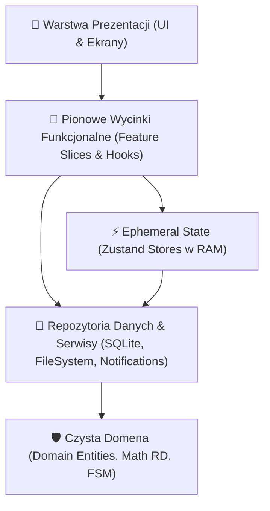
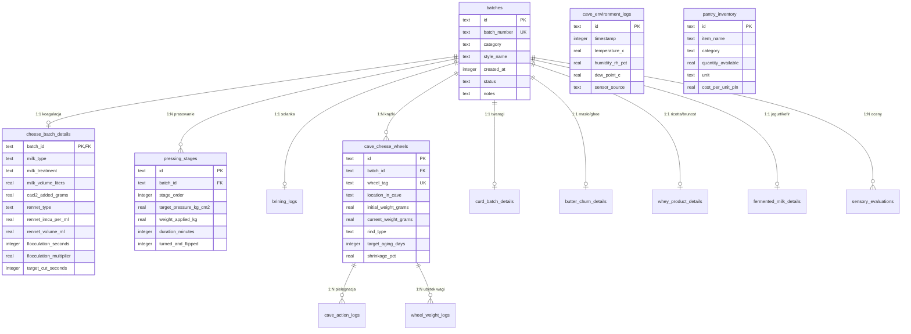

# **SEROWAR — Architektura Techniczna i Projekt Inżynieryjny (System Architecture)**

> **Rola:** Principal System Architect, Lead Software Engineer & Data Modeling Strategist  
> **Projekt:** SEROWAR (Rzemieślnicze Przetwórstwo Mleka) | `com.apps4brew.serowar`  
> **Data opracowania:** 17.10.2026  
> **Status:** **PROPOSED / IN REVIEW (Bramka STOP Architekta)**  
> **Powiązania:** [`docs/scope-contract.md`](file:///C:/Users/lukas/Documents/antigravity/calm-planck/docs/scope-contract.md), [`docs/brd/D2_Architektura_Model_SQLite.md`](file:///C:/Users/lukas/Documents/antigravity/calm-planck/docs/brd/D2_Architektura_Model_SQLite.md), [`docs/brd/D1_Wymagania_Niefunkcjonalne.md`](file:///C:/Users/lukas/Documents/antigravity/calm-planck/docs/brd/D1_Wymagania_Niefunkcjonalne.md)

---

## 1. Wymagania Niefunkcjonalne (NFR) i Profil Obciążeniowy

### 1.1 Wymagania NFR
* **`NFR-OFF` (100% Offline-First):** Zero zewnętrznych serwerów, brak logowania, brak wymogu dostępu do sieci. Koszt krańcowy utrzymania chmury wynosi **$0.00**.
* **`NFR-WYD` (Wydajność):**
  * Czas wykonania każdego zapytania SQL $\le 5\text{ ms}$ dzięki indeksom B-Tree.
  * Płynność interfejsu 60/120 FPS na urządzeniach z systemem iOS i Android.
  * Czas zimnego startu aplikacji $< 800\text{ ms}$.
* **`NFR-DANE` (Integralność i Trwałość):**
  * Transakcyjność ACID (`PRAGMA foreign_keys = ON`, `PRAGMA journal_mode = WAL`).
  * Ochrona przed błędem systemowym iOS `0xDEAD10CC` poprzez `PRAGMA busy_timeout = 5000`.
  * Silnik rotacji 10 kopii zapasowych JSON z sumą kontrolną SHA-256 oraz zasadą *Graceful Rejection*.
* **`NFR-ZEG` (Peryferia i Zegarki):**
  * Resilient timers oparte o czas UTC (`Date.now()`), odporne na ubicie wątków JS w tle przez iOS.
  * Wsparcie dla Live Activity / Dynamic Island na ekranie blokady oraz powiadomień na Apple Watch.

### 1.2 Profil Skali Danych (5-letnia projekcja rzemieślnika)
* Średnia produkcja domowa/zagrodowa: 1–2 partie sera / nabiału tygodniowo ($\sim 75$ partii/rok).
* Pomiary środowiskowe Cave Log: 1–2 wpisy dziennie ($\sim 500$ wpisów/rok).
* Czynności pielęgnacyjne krążków (obracanie, przemywanie, ważenie): $\sim 400$ logów/rok.
* Szacowany rozmiar bazy SQLite po 5 latach: **$< 15\text{ MB}$**.
* Całość bazy mieści się w pamięci podręcznej SQLite cache (`PRAGMA cache_size = -64000` czyli 64 MB), co gwarantuje operacje w pamięci RAM bez wąskich gardeł I/O dysku flash.

---

## 2. Podział Warstwowy: Czysta Architektura (Clean Architecture & Ports & Adapters)

Kod aplikacji podlega bezwzględnej regule jednokierunkowej zależności (Dependency Rule):

> **Złoty Niezmiennik Architektury:**  
> Warstwa czystej logiki domenowej (`src/core/domain/`) składa się wyłącznie z deterministycznego TypeScriptu. **Zakaz importowania** jakichkolwiek bibliotek frameworka (`react`, `react-native`, `expo-*`, `@react-navigation/*`). Logika matematyczna (reguły `RD-01…RD-50`) testowana jest w 1 milisekundę.

---

## 3. Trójwarstwowa Architektura Stanu (3-Tier State Architecture)

Aplikacja rozróżnia trzy ściśle odseparowane poziomy stanu:

1. **Persisted State (Trwały — Baza SQLite na dysku):**
   * *Single Source of Truth:* partie mleczarskie, szczegóły koagulacji, harmonogramy prasowania, solanki, krążki w Cave Log, odczyty mikroklimatu, inwentarz spiżarni, oceny sensoryczne.
   * Dostęp poprzez asynchroniczne repozytoria transakcyjne.
2. **Ephemeral UI State (Ul جمny — Zustand w pamięci RAM):**
   * Aktywny krok w kreatorze warzenia sera, otwarte modale, wartości suwaków kalkulatora przed zatwierdzeniem, filtry listy krążków, stan wyszukiwania.
   * Wykorzystanie memoizowanych selektorów Zustand eliminujących niepotrzebne re-rendery widoków.
3. **Hardware & Peripherals State (Stan Sprzętowy):**
   * Maszyny stanów odliczania flokulacji i Live Activity w ActivityKit.
   * W wersji 1.1: stan połączenia BLE dla czujników RuuviTag/Mijia (`DISCONNECTED` $\rightarrow$ `SCANNING` $\rightarrow$ `CONNECTING` $\rightarrow$ `STREAMING`).

---

## 4. Diagram Relacji Encji (Mermaid ERD — 18 Tabel Mleczarskich)

---

## 5. Tabela Kwalifikacji Modułów Inżynieryjnych

| Moduł Inżynieryjny | Status Kwalifikacji | Uzasadnienie Architektoniczne |
| :--- | :---: | :--- |
| **`sqlite-i-migracje-ddl.md`** | **ZAKWALIFIKOWANY (Kluczowy)** | Zapewnia deterministyczny schemat 18 tabel DDL, indeksy B-Tree $<5\text{ ms}$, transakcje ACID i migracje bez utraty danych. |
| **`offline-first-i-synchronizacja.md`** | **ZAKWALIFIKOWANY (Kluczowy)** | Gwarantuje działanie w piwnicach i jaskiniach serowych bez internetu, eksport JSON z SHA-256 i zero kosztów serwerowych. |
| **`zarzadzanie-stanem-i-reaktywnosc.md`** | **ZAKWALIFIKOWANY (Kluczowy)** | Podział stanu na SQLite, Zustand w RAM i FSM; eliminuje re-rendery na iOS/Android. |
| **`modularnosc-i-clean-architecture.md`** | **ZAKWALIFIKOWANY (Kluczowy)** | Izolacja czystej domeny matematycznej (`src/core/domain/`) od frameworków UI. Umożliwia testy w 1 ms. |
| **`peryferia-i-praca-w-tle.md`** | **ZAKWALIFIKOWANY (Kluczowy)** | Resilient timer czasu flokulacji i Live Activity; wzorzec ponownego łączenia BLE przygotowany pod v1.1. |
| **`harvesting-i-synergia-portfolio.md`** | **ZAKWALIFIKOWANY (Kluczowy)** | Reużycie silnika SQLite WAL ze *Słoik* / *Napar*, logowania serii z *Trening* i powiadomień z *Organizer*. |
