# **SEROWAR — Architektura i Przepływy To-Be (docs/to-be.md)**

> **Ekosystem:** Apps4Brew Studio | **Projekt:** SEROWAR (Rzemieślnicze Przetwórstwo Mleka)  
> **Rola:** Principal Product Architect & Senior UX Designer (`coding/bpr-ux`)  
> **Powiązania:** Decyzja `DEC-UX-01: A` (4 Zakładki) | Wzorce BPR P1–P18 | Anti-AI Slop Mandate  
> **Data opracowania:** 17.10.2026

---

## **1. Nowa Mapa Nawigacji To-Be (Dekompozycja 4 Zakładek)**

Zgodnie z zatwierdzoną decyzją **`DEC-UX-01: A`** oraz wzorcem **`P17: Anti-Combine`** dotychczasowe 5 zakładek oraz moduły kiszonek/kombuchy zostają zastąpione **4 ergonomicznymi zakładkami operacyjnymi**:

```mermaid
flowchart TD
    AppRoot["📱 SEROWAR App Root Layout (app/(tabs)/_layout.tsx)"]
    
    Tab1["🧀 Zakładka 1: SEROWAR (index.tsx)"]
    Tab2["🧈 Zakładka 2: NABIAŁ & KUCHNIA (dairy.tsx)"]
    Tab3["🏔️ Zakładka 3: DOJRZEWALNIA (cave.tsx)"]
    Tab4["📦 Zakładka 4: SPIŻARNIA & WIEDZA (pantry-knowledge.tsx)"]
    
    AppRoot --> Tab1
    AppRoot --> Tab2
    AppRoot --> Tab3
    AppRoot --> Tab4
    
    Tab1 --> T1_Calc["1. Kalkulator Mleka & IMCU (P4)"]
    Tab1 --> T1_Floc["2. Stoper Flokulacji tf × M (P5, P11)"]
    Tab1 --> T1_Press["3. Kaskada Nacisku Prasy kg/cm² (P16)"]
    Tab1 --> T1_Brine["4. Kąpiel Solankowa & Densitometria"]
    Tab1 --> T1_Handoff["5. Przycisk: Przenieś do Dojrzewalni (P9, P14)"]
    
    Tab2 --> T2_Curd["1. Twarogi Klinkowe & pI 4.6 (Rampa <44°C)"]
    Tab2 --> T2_Butter["2. Masielnictwo Rzemieślnicze & Ghee"]
    Tab2 --> T2_Bev["3. Napoje Fermentowane (Jogurt/Kefir)"]
    Tab2 --> T2_Whey["4. Zamknięty Obieg Serwatki (Ricotta/Brunost)"]
    
    Tab3 --> T3_Feed["1. Proaktywny Feed: Zadania na Dziś (P6)"]
    Tab3 --> T3_Cards["2. Karty Krążków z Paskiem Dojrzewania (P2)"]
    Tab3 --> T3_Climate["3. Mikroklimat & Alert Punktu Rosy (P11)"]
    Tab3 --> T3_Action["4. Szybki Obrót / Pielęgnacja + Undo (P10)"]
    
    Tab4 --> T4_Pantry["1. Spiżarnia & Auto-Odpis Surowców (P7)"]
    Tab4 --> T4_Labels["2. Generator Etykiet QR PDF (expo-print)"]
    Tab4 --> T4_Doctor["3. Kanoniczny Cheese Doctor (P1)"]
    Tab4 --> T4_School["4. Szkoła Mleczarstwa (Lekcje Terenowe)"]
    Tab4 --> T4_Backup["5. Kopia Zapasowa JSON & Ustawienia 35 Języków"]
```



---

## **2. Szczegółowe Przepływy Użytkownika To-Be**

### **Przepływ 1: Pierwsze Uruchomienie (Direct-to-Milk Dashboard)**
* **Kiedy używasz:** Nowy serowar otwiera aplikację po raz pierwszy, trzymając telefon w kuchni.
* **Sekwencja:**
  ```text
  [Otwarcie App] ──> [Natychmiastowy Pulpit Warsztatowy SEROWAR (Tab 1)]
                           │
                           ├──> Domyślnie: Mleko Krowie 10L, 200 IMCU/ml
                           ├──> Wyliczona dawka podpuszczki (ml i krople)
                           └──> Gotowy przycisk: "Rozpocznij zaprawianie (t0)"
  ```
* **Uproszczenie BPR:** Zero ekranów powitalnych, zero karuzel reklamowych, zero przełączników kiszonek (`P17`). Rzemieślnik od pierwszej sekundy widzi działający pulpit kalkulatora (`P18`).
* **Koszt To-Be:** Ekrany: **1** | Kliknięcia: **0** (gotowy wynik) | Pola: **0** | Decyzje: **0**

---

### **Przepływ 2: Ciągły Proces — Wsad, Flokulacja, Prasa i Przekazanie do Jaskini (Guided Cheese Crafting)**
* **Kiedy używasz:** Przeprowadzenie pełnego warzenia sera podpuszczkowego od mleka do leżakowania.
* **Sekwencja:**
  ```text
  [Wsad Mleka] ──> [Żywy Wynik IMCU & CaCl2] ──> [Tapnięcie: Start Zaprawiania t0]
                          │
                          ▼
  [Tryb Skupiony: Stoper Flokulacji] ──> [Tapnięcie tf (miseczka)] ──> [Auto-odliczanie t_cut]
                          │
                          ▼
  [Zwijana Karta Prasy: Kaskada kg/cm²] ──> [Stoper Solanki]
                          │
                          ▼
  [CTA: Przenieś do Dojrzewalni] ──> [Automatyczny zapis partii do Cave Log w SQLite WAL]
  ```
* **Uproszczenie BPR:** Ciągły łańcuch technologiczny (`P14`). Wbudowany stoper flokulacji i kaskada prasy (`P5`, `P16`). Po wyjęciu sera z solanki jedno tapnięcie tworzy gotowy rekord krążka w Dojrzewalni (`P9`) z wyliczoną datą dojrzałości i kodem partii — bez ponownego wpisywania danych!
* **Koszt To-Be:** Ekrany: **1** (jeden prowadzony widok) | Kliknięcia: **5–7** (zamiast 16!) | Pola: **2** | Decyzje: **1**

---

### **Przepływ 3: Dojrzewalnia i Proaktywny Feed Zabiegów (Affinage Feed)**
* **Kiedy używasz:** Codzienny obchód piwniczki serowarskiej i pielęgnacja skórek.
* **Sekwencja:**
  ```text
  [Otwarcie Tab 3: DOJRZEWALNIA]
          │
          ▼
  [Pasek Mikroklimatu: 12°C | 85% RH | Punkt Rosy: Bezpiecznie]
          │
          ▼
  [Feed "Zadania na dziś"]:
     • Gouda #01 ── [Obróć krążek] ──> Natychmiastowy zapis + Snackbar "Cofnij (Undo)"
     • Koryciński #02 ── [Przemyj solanką maziową] ──> Zapis pielęgnacji
          │
          ▼
  [Karty Krążków z pajączkiem dojrzałości sensorycznej]
  ```
* **Uproszczenie BPR:** Dedykowana zakładka (`P2`). Zastąpienie pasywnej listy proaktywnym feedem zadań (`P6`). Zapis obrotu jednym tapnięciem z mechanizmem Undo (`P10`) bez irytujących wyskakujących okienek dialogowych.
* **Koszt To-Be:** Ekrany: **1** | Kliknięcia: **1–2** (zamiast 6) | Pola: **0** | Decyzje: **0**

---

### **Przepływ 4: Spiżarnia, Generator Etykiet QR PDF i Koszty**
* **Kiedy używasz:** Podgląd magazynu, automatyczny odpis po sesji oraz druk arkusza A4 samoprzylepnych etykiet partii.
* **Sekwencja:**
  ```text
  [Karta Partii Sera / Tab 4] ──> [Generuj Etykietę QR PDF] ──> [Podgląd wydruku expo-print]
  ```
* **Uproszczenie BPR:** Skrót do etykiety bezpośrednio z karty partii (`P5`), usunięcie zduplikowanych kalkulatorów kosztów (`P1`), auto-odpis surowców ze spiżarni (`P7`).
* **Koszt To-Be:** Ekrany: **1** | Kliknięcia: **3–4** (zamiast 9) | Pola: **1** | Decyzje: **1**

---

### **Przepływ 5: Kanoniczny Cheese Doctor, Wiedza i Kopia Zapasowa**
* **Kiedy używasz:** Diagnoza niepokojącego objawu na skórce sera lub wykonanie kopii JSON.
* **Sekwencja:**
  ```text
  [Tab 4: SPIŻARNIA & WIEDZA] ──> [Wybór: Szkoła & Doctor / Ustawienia & Kopia]
                                            │
                                            ▼
                               [Interaktywne drzewo diagnostyczne wad]
  ```
* **Uproszczenie BPR:** Jeden kanoniczny Cheese Doctor (`P1`), scalenie ustawień i kopii zapasowej do zakładki 4, eliminacja 5. zakładki paska dolnego (`P3`).
* **Koszt To-Be:** Ekrany: **1** | Kliknięcia: **2–3** (zamiast 8) | Pola: **0** | Decyzje: **1**

---

## **3. Tabela Porównawcza Kosztu: As-Is vs To-Be**

| Obszar / Przepływ | Ekrany (Było $\to$ Jest) | Kliknięcia (Było $\to$ Jest) | Pola (Było $\to$ Jest) | Zysk BPR (Redukcja wysiłku) |
|---|:---:|:---:|:---:|---|
| **1. Pierwsze Uruchomienie** | 1 $\to$ 1 | 3–5 $\to$ **0** | 0 $\to$ 0 | **100% natychmiastowa gotowość**, eliminacja chaosu kiszonek |
| **2. Główny Proces (Wsad $\to$ Cave Log)** | 2 $\to$ **1** | 12–16 $\to$ **5–7** | 6–8 $\to$ **2** | **Redukcja kliknięć o 60%**, automatyczny transfer parametrów partii |
| **3. Dojrzewalnia (Cave Log)** | 1 (ukryty) $\to$ **1 (Tab 3)** | 4–6 $\to$ **1–2** | 0–1 $\to$ 0 | **Dedykowany feed na dziś**, obrót jednym tapnięciem + Undo |
| **4. Spiżarnia i Etykiety QR** | 1 $\to$ 1 | 7–9 $\to$ **3–4** | 4 $\to$ **1** | **Etykieta bezpośrednio z partii**, auto-odpis surowców |
| **5. Szkoła, Doctor i Ustawienia** | 2 $\to$ **1 (Tab 4)** | 5–8 $\to$ **2–3** | 0 $\to$ 0 | **Jeden kanoniczny Doctor**, redukcja z 5 do 4 zakładek |
| **ŁĄCZNIE W CAŁEJ APLIKACJI** | **7 $\to$ 4** | **31–44 $\to$ 11–16** | **10–13 $\to$ 3** | **Ponad 65% redukcji kliknięć i 70% redukcji wpisywanych pól!** |

---

## **4. Rejestr Decyzji Architektonicznych To-Be**

| Decyzja / Zmiana | Wzorce BPR | Zysk dla Użytkownika | Ryzyko i Mitygacja | Wpływ na Dane | Wysiłek |
|---|:---:|---|---|:---:|:---:|
| **DEC-BPR-01: Redukcja Zakładek do 4 (DEC-UX-01)** | `P3`, `P17` | Duże, ergonomiczne przyciski w strefie kciuka, 100% profilu mleczarskiego. | Ryzyko: stare testy tras. Mitygacja: aktualizacja `matrix-routes.test.tsx`. | Brak | **M** |
| **DEC-BPR-02: Usunięcie Sekcji Kiszonek/Kombuchy z UI** | `P17` | Czysty pulpit bez obcych fermentacji roślinnych. | Logika w `src/core/` pozostaje na potrzeby testów i *Słoika*. | Zerowy | **S (Quick Win)** |
| **DEC-BPR-03: Ciągły Kreator Sesji (Wsad $\to$ Cave Log)** | `P14`, `P4`, `P9` | Dane wsadu i flokulacji tworzą krążek w jaskini jednym tapnięciem. | Ryzyko: niepełne dane. Mitygacja: bezpieczne wartości domyślne. | Zapis w `batches` & `cave_cheese_wheels` | **M** |
| **DEC-BPR-04: Proaktywny Feed Zadań na Dziś w Tab 3** | `P6`, `P10` | Serowar od razu wie, które krążki obrócić; odznaczenie + Undo. | Brak ryzyka — uproszczenie logiki zapytań SQL. | Aktualizacja `last_turned_at` | **M** |
| **DEC-BPR-05: Unifikacja Cheese Doctora w Tab 4** | `P1` | Jedno, spójne drzewo diagnostyczne wad sera. | Usunięcie duplikatu z widoku wiedzy. | Brak | **S (Quick Win)** |
| **DEC-BPR-06: Warsztatowy Design P18 (Pulpit Surowcowy)** | `P18` | Brak rozmytych cieni, mikro-ramki 1px, `tabular-nums`, paleta *Cellar Slate* & *Butter Cream*. | Pełna zgodność z WCAG AAA (wyrocznia kontrastu zbadana). | Wizualny | **M** |

---

## **5. Priorytetyzacja Wdrożenia (Zysk ÷ Wysiłek)**

1. **KROK 1 (Quick Win — P17):** Oczyszczenie głównego ekranu z przełącznika `cheese/veg/beverage` i ukrycie modułów roślinnych w UI.
2. **KROK 2 (Architektura Nawigacji — P3, DEC-UX-01):** Konfiguracja `app/(tabs)/_layout.tsx` na 4 zakładki (`index`, `dairy`, `cave`, `pantry-knowledge`).
3. **KROK 3 (Ciągły Asystent Sesji — P4, P5, P14):** Połączenie wsadu mlecznego ze stoperem flokulacji, kaskadą prasy i bezpośrednim zapisem krążka do Cave Log.
4. **KROK 4 (Proaktywny Feed Dojrzewalni — P6, P10):** Wdrożenie feedu *„Zadania na dziś”* w `cave.tsx` z szybką akcją obrotu i Snackbar Undo.
5. **KROK 5 (Konsolidacja Spiżarni i Wiedzy — P1, P7):** Scalenie inwentarza, generatora etykiet QR i kanonicznego Cheese Doctora w `pantry-knowledge.tsx`.
6. **KROK 6 (Weryfikacja Regresji & Stylistyka P18):** Wdrożenie stylów mikro-ramek 1px i `tabular-nums`, aktualizacja testów tras i uruchomienie pełnego `npm run verify`.

---

## **6. Plan Wdrożenia (Etap 3 — Samodzielne Commity)**

* **Commit 1:** `refactor(tabs): migrate navigation layout to 4 ergonomic tabs per DEC-UX-01`
* **Commit 2:** `refactor(cheese-craft): streamline main crafting assistant into continuous workflow (P4, P5, P14)`
* **Commit 3:** `feat(cave-log): implement proactive daily affinage feed with one-tap undo (P6, P10)`
* **Commit 4:** `refactor(pantry-knowledge): consolidate pantry, QR label print, and canonical cheese doctor (P1, P7)`
* **Commit 5:** `style(ui): apply anti-ai slop workshop dashboard styles, 1px borders, and tabular-nums (P18)`
* **Commit 6:** `test(routes): update matrix routes, e2e maestro tests, and verify suite`
