# **SEROWAR — Architektura Ekranów i Blueprint UX (docs/ux/blueprint-ekranow.md)**

> **Ekosystem:** Apps4Brew Studio | **Projekt:** SEROWAR (Rzemieślnicze Przetwórstwo Mleka)  
> **Rola:** UX Product Design Research & Blueprint (`analysis/ux-product-design-research`)  
> **Powiązanie architektoniczne:** Decyzja `DEC-UX-01: A` (4 Zakładki Główne) + Norma `docs/32-wzorce-interakcji.md`  
> **Data opracowania:** 17.10.2026

---

## **1. Architektura Informacji (IA) i Drzewo Nawigacji**

Zgodnie z zatwierdzoną decyzją **`DEC-UX-01: A`** dolny pasek nawigacyjny (Tab Bar) składa się z **4 głównych zakładek operacyjnych**, zoptymalizowanych pod kątem ergonomii kciuka i pracy w kuchni:

```mermaid
graph TD
    Root[SEROWAR App Root Layout] --> Tab1["🧀 Zakładka 1: SEROWAR"]
    Root --> Tab2["🧈 Zakładka 2: NABIAŁ & KUCHNIA"]
    Root --> Tab3["🏔️ Zakładka 3: DOJRZEWALNIA (CAVE LOG)"]
    Root --> Tab4["📦 Zakładka 4: SPIŻARNIA & WIEDZA"]

    Tab1 --> Mode1A["Kalkulator Mleka & IMCU"]
    Tab1 --> Mode1B["Stoper Flokulacji"]
    Tab1 --> Mode1C["Kalkulator Prasy"]
    Tab1 --> Mode1D["Kąpiel Solankowa"]

    Tab2 --> Mode2A["Twarogi Klinkowe & pI 4.6"]
    Tab2 --> Mode2B["Masielnictwo & Ghee"]
    Tab2 --> Mode2C["Napoje Fermentowane (Jogurt/Kefir)"]
    Tab2 --> Mode2D["Obieg Serwatki (Ricotta & Brunost)"]

    Tab3 --> CaveViewA["Kartoteka Krążków w Leżakowaniu"]
    Tab3 --> CaveViewB["Harmonogram Obracania & Mazi"]
    Tab3 --> CaveViewC["Psychrometria Jaskini & BLE"]

    Tab4 --> Hub4A["Spiżarnia & Auto-Odpis Surowców"]
    Tab4 --> Hub4B["Generator Etykiet QR PDF"]
    Tab4 --> Hub4C["Kalkulator Kosztów & Wydajności % Yield"]
    Tab4 --> Hub4D["Szkoła Mleczarstwa & Cheese Doctor"]
    Tab4 --> Hub4E["Ustawienia & Kopia Zapasowa JSON"]
```

---

## **2. Szczegółowa Specyfikacja Czterech Zakładek Głównych**

### **2.1 Zakładka 1: 🧀 SEROWAR (`app/(tabs)/index.tsx`)**
Główny pulpit serowarstwa podpuszczkowego. Służy do przygotowania wsadu mlecznego i przeprowadzenia koagulacji, obróbki skrzepu, prasowania i solenia.

* **Nagłówek (`Header`):**
  * Tytuł: **„SEROWAR”** (font: `Tektur Bold 20pt`).
  * `headerRight`: Przycisk `+` z etykietą VoiceOver: `accessibilityLabel="Dodaj nową partię sera"`.
* **Przełącznik Trybu (`Mode Switcher`):**
  * Segmented control: `[Mleko & IMCU, Flokulacja, Prasa, Solanka]`.
* **Sekcja 1: Kalkulator Mleka & Podpuszczki IMCU:**
  * Wybór gatunku mleka: Krowie | Kozie | Owcze | Bawole (ikony wektorowe + domyślny profil białko/tłuszcz).
  * Wybór obróbki: Surowe zagrodowe | Pasteryzowane niskotemperaturowo | Sklepowe mikrofiltrowane.
  * Blokada UHT: natychmiastowe okno edukacyjne przy próbie wyboru mleka sterylizowanego.
  * Pole numeryczne: Objętość mleka (litry, step 0.5L).
  * Kalkulator $CaCl_2$: gramy proszku bezwodnego oraz mililitry/krople roztworu 33%.
  * Kalkulator Podpuszczki: przelicznik siły IMCU/ml lub tradycyjnej 1:X, wynik w ml i kroplach.
* **Sekcja 2: Asystent Flokulacji (Flocculation Multiplier):**
  * Karta skupiona (Focused View): Stoper od zaprawienia ($t_0$).
  * Duży przycisk Thumb Zone: **„Punkt Flokulacji ($t_f$)”** — zatrzymanie obrotu miseczki.
  * Suwak / selektor stylu sera z mnożnikiem $M$ (Alpejskie 2.0x, Gouda 3.0x, Camembert 4.5x, Koryciński 5.5x).
  * Odliczanie do cięcia skrzepu ($t_{cut} = t_f \times M$) z podglądem w Live Activity i na Apple Watch.
* **Sekcja 3: Asystent Prasy Serowarskiej:**
  * Średnica formy (cm) $\rightarrow$ pole powierzchni $A$ ($cm^2$).
  * Typ prasy: Bezpośrednia ($R=1$) | Dźwignia holenderska | Manometr pneumatyczny.
  * Harmonogram 4 etapów nacisku z alertami dźwiękowymi o konieczności odwrócenia sera w chuście.
* **Sekcja 4: Kąpiel Solankowa:**
  * Kalkulator soli dla solanki nasyconej (18–22% NaCl, bufor $CaCl_2$ 0.15%, kwas mlekowy/serwatka).
  * Przelicznik hydrometryczny (°Baumé, Salometer, gęstość g/cm³ z kompensacją temperatury).
  * Stoper kąpieli z powiadomieniem w połowie czasu na obrót pływającego krążka.

---

### **2.2 Zakładka 2: 🧈 NABIAŁ & KUCHNIA (`app/(tabs)/dairy.tsx`)**
Centrum domowego przetwórstwa mlecznego poza serami podpuszczkowymi. Prowadzi użytkownika przez twarogi, masło, napoje fermentowane i zamknięty obieg serwatki.

* **Nagłówek (`Header`):**
  * Tytuł: **„Nabiał & Kuchnia”** (font: `Tektur Bold 20pt`).
  * `headerRight`: Przycisk `+` z etykietą VoiceOver: `accessibilityLabel="Dodaj nową partię nabiału"`.
* **Przełącznik Trybu (`Mode Switcher`):**
  * Segmented control: `[Twarogi, Masielnictwo, Napoje, Obieg Serwatki]`.
* **Sekcja 1: Twarogi Klinkowe & Sery Świeże:**
  * Wskaźnik punktu izoelektrycznego kazeiny ($pH = 4.60$).
  * Monitor rampy łagodnego dogrzewania skrzepu (38–42°C) z alarmem przekroczenia 44°C (ochrona przed stwardnieniem twarogu).
  * Stoper grawitacyjnego odcieku serwatki w chuście klinkowej z wyliczaniem docelowej wilgotności.
  * Moduły specjalne: Labneh (odsączanie jogurtu w worku), Paneer & Chhena (termiczno-kwasowa koagulacja w 85°C).
* **Sekcja 2: Masielnictwo Rzemieślnicze & Ghee:**
  * Kalkulator zmaślania: masa śmietanki $\times$ % tłuszczu $\rightarrow$ wydajność masła (82.5%) i maślanki.
  * Asystent okna temperaturowego (10–14°C) z kompensacją lato/zima.
  * Asystent inwersji emulsji (faza pęcherzyków $\rightarrow$ faza "popcornu" ziaren masła).
  * Procedura płukania wodą lodową (<5°C) i wyciskania resztek maślanki na deskach bukowych.
  * Protokół wytapiania ghee: kontrola temperatury 100–105°C, odparowanie wody, punkt dymienia 250°C.
* **Sekcja 3: Napoje Fermentowane:**
  * Fermentacja termofilna jogurtu w 42–45°C (symbioza *S. thermophilus* + *L. bulgaricus*).
  * Odsączanie jogurtu greckiego (redukcja serwatki o 50%).
  * Tradycyjny kefir na ziarnach grzybka tybetańskiego z kalendarzem rotacji kultur.
  * Świeża maślanka rzemieślnicza bogata w fosfolipidy MFGM.
* **Sekcja 4: Zamknięty Obieg Serwatki (Zero-Waste Whey Loop):**
  * Rzemieślnicza Ricotta: termiczna denaturacja albumin w 88°C z korektą pH (5.9) kwasem spożywczym.
  * Opcja wzbogacenia: dodatek 5–10% mleka pełnego dla podwojenia wydajności.
  * Norweski Brunost / Mysost: redukcja serwatki z odparowaniem wody do 80% suchej masy w 102–105°C, karmelizacja laktozy i schładzanie w kąpieli lodowej (ochrona przed piaszczystością).

---

### **2.3 Zakładka 3: 🏔️ DOJRZEWALNIA (CAVE LOG) (`app/(tabs)/cave.tsx`)**
Dedykowana cyfrowa piwniczka serowarska. Nadzoruje procesy leżakowania (od 2 tygodni do 2 lat).

* **Nagłówek (`Header`):**
  * Tytuł: **„Dojrzewalnia (Cave Log)”** (font: `Tektur Bold 20pt`).
  * `headerRight`: Przycisk `+` z etykietą: `accessibilityLabel="Dodaj krążek do dojrzewalni"`.
* **Karta Podsumowująca Mikroklimat Jaskini:**
  * Bieżąca temperatura (°C) i wilgotność względna (% RH).
  * Wyliczony punkt rosy ($T_{dp}$) i wskaźnik deficytu prężności pary wodnej (VPD).
  * Status połączenia z czujnikiem BLE (RuuviTag / Xiaomi Mijia) lub znacznik odczytu ręcznego.
* **Lista Aktywnych Krążków Sera (Summary Cards):**
  * Każda karta prezentuje: Nazwę sera, kod partii (`SER-2026-10-GOU-01`), wiek (np. *„Dzień 42 z 90”*), pasek postępu leżakowania, aktualną wagę i ubytek (% shrinkage).
  * Typ skórki: Maziowa (*B. linens*), Pleśniowa biała (*P. camemberti*), Pleśniowa niebieska (*P. roqueforti*), Naturalna oliwiona, Parafinowana.
  * Szybka akcja jednym tapnięciem: **„Obróć krążek”** (natychmiastowy zapis w SQLite WAL i aktualizacja daty ostatniego obrotu).
* **Harmonogram Zabiegów Pielęgnacyjnych:**
  * Lista zadań na dziś: krążki do obrócenia, krążki do przemycia lekką solanką maziową, termin nakłucia igłami dla sera z niebieską pleśnią.
* **Wizualny Radar Sensoryczny Dojrzałości:**
  * Wektorowy pajączek SVG oceniający 6 osi: kwasowość, słoność, elastyczność, kremowość, ostrość, orzechowość.

---

### **2.4 Zakładka 4: 📦 SPIŻARNIA & WIEDZA (`app/(tabs)/pantry-knowledge.tsx`)**
Gospodarka surowcowa, narzędzia wydruku i diagnostyki oraz ustawienia systemowe.

* **Nagłówek (`Header`):**
  * Tytuł: **„Spiżarnia & Wiedza”** (font: `Tektur Bold 20pt`).
  * `headerRight`: Ikona skanera aparatu QR z etykietą: `accessibilityLabel="Zeskanuj kod QR partii"`.
* **Przełącznik Trybu (`Mode Switcher`):**
  * Segmented control: `[Spiżarnia, Etykiety & Koszty, Szkoła & Doctor, Ustawienia]`.
* **Sekcja 1: Spiżarnia Surowców (Pantry Inventory):**
  * Kartoteka zapasów z automatycznym odpisem po sesji: mleko, śmietanka, kultury DVI, podpuszczki, sól niejodowana, chlorek wapnia, zioła.
  * Ostrzeżenia o kończących się terminach przydatności kultur liofilizowanych.
* **Sekcja 2: Paszporty i Generator Etykiet QR PDF:**
  * Generator arkusza A4 samoprzylepnych etykiet serowarskich przez `expo-print`.
  * Etykieta zawiera: kod partii, datę udoju, styl sera, gatunek mleka oraz wektorowy kod QR z deep-linkiem `serowar://batch/<id>`.
  * Skaner QR przez `expo-camera` do błyskawicznego otwarcia karty sera leżącego na półce.
* **Sekcja 3: Kalkulator Ekonomiczny Partii:**
  * Obliczanie wydajności serowarskiej (% Cheese Yield z litra mleka).
  * Kalkulator kosztu wytworzenia kilograma sera i kostki masła (surowce + energia grzania/chłodzenia).
  * Porównanie z cenami delikatesów rzemieślniczych i wyliczenie oszczędności portfela.
* **Sekcja 4: Szkoła Mleczarstwa & Diagnostyk Wad (Doctor):**
  * Baza wiedzy o chemii mleka, micelach kazeiny i fizjologii kultur bakterii.
  * **Cheese Doctor:** interaktywne drzewo diagnostyczne wad sera (wzdęcie wczesne *Coli*, wzdęcie późne *Clostridium*, gorzknienie, śluzowacenie skórki w solance).
  * **Dairy Doctor:** diagnostyk wad masła (zjełczenie, kropelkowanie), twarogu (kredowość, mazistość) i jogurtu.
* **Sekcja 5: Ustawienia i Kopia Zapasowa:**
  * Przełącznik jednostek (Metryczne / Imperialne).
  * Wybór języka (35 języków z domyślnym językiem systemowym).
  * Kopia zapasowa: eksport bazy SQLite do pliku JSON, przywracanie z kopii, eksport partii do CSV.
  * Status licencji (SEROWAR PRO / Wersja Bezpłatna) z przyciskiem przywracania zakupów (*Restore Purchases*).

---

## **3. Przepływy Formularzy Modalnych (Modal Dialog Flows)**

Zgodnie z żelazną regułą `docs/32`:
- Każdy formularz edycyjny posiada w `headerLeft` dosłowny przycisk **„Anuluj”**, a w `headerRight` przycisk **„Dodaj”** lub **„Zapisz”**.
- Modyfikacja pól aktywuje `Dirty State Guard` — dotknięcie „Anuluj” wywołuje monit: *„Odrzucić zmiany?”*.

| Nazwa widoku modalnego | Ścieżka / Komponent | Cel i operacje użytkownika |
|---|---|---|
| **`NewBatchModal`** | `app/modal/new-batch.tsx` | Kreator nowej partii: wybór kategorii (ser podpuszczkowy, twaróg, masło, napój, ricotta, brunost), nazwa, wsad mleczny. Przycisk: **„Dodaj”**. |
| **`EditBatchModal`** | `app/modal/edit-batch.tsx` | Modyfikacja notatek, wagi bieżącej lub parametrów dojrzewania istniejącego sera. Przycisk: **„Zapisz”**. |
| **`FlocculationModal`** | `app/modal/flocculation.tsx` | Pełnoekranowy asystent wirującej miseczki, detekcja $t_f$, przeliczenie czasu cięcia, start timera. |
| **`PressScheduleModal`**| `app/modal/press-schedule.tsx`| Kreator harmonogramu nacisku prasy: definiowanie etapów, obliczanie wagi obciążnika dla zadanego $kg/cm^2$. |
| **`BrineTimerModal`**   | `app/modal/brine-timer.tsx` | Stoper kąpieli solankowej z powiadomieniem w połowie czasu na odwrócenie krążka. |
| **`ChurnAssistantModal`**| `app/modal/churn-assistant.tsx`| Prowadzenie przez etapy zmaślania śmietanki, płukania wodą lodową i mechanicznego wyciskania. |
| **`WheyLoopModal`**     | `app/modal/whey-loop.tsx` | Kreator odzysku serwatki: kalkulator kwasu dla Ricotty lub kalkulator odparowania dla Brunostu. |
| **`SensorBleModal`**    | `app/modal/sensor-ble.tsx` | Skaner bezprzewodowych tagów BLE (RuuviTag, Mijia), parowanie z półką w dojrzewalni. |
| **`LabelPrintModal`**   | `app/modal/label-print.tsx` | Konfigurator i podgląd arkusza etykiet PDF przed wysłaniem do AirPrint lub zapisem w plikach. |
| **`DoctorModal`**       | `app/modal/doctor.tsx` | Interaktywny wywiad objawowy (wygląd, zapach, smak, konsystencja) z werdyktem i procedurą naprawczą. |

---

## **4. Macierz 9 Stanów UI dla Głównych Widoków**

Poniższa macierz definiuje zachowanie interfejsu w każdym z 9 stanów systemowych dla 4 zakładek:

| Stan UI | 🧀 Zakładka 1: SEROWAR | 🧈 Zakładka 2: NABIAŁ | 🏔️ Zakładka 3: DOJRZEWALNIA | 📦 Zakładka 4: SPIŻARNIA |
|---|---|---|---|---|
| **1. Domyślny (Golden Path)** | Formularz kalkulatora z ostatnio użytym gatunkiem mleka, aktywne przyciski obliczeń. | Karta zoptymalizowanych temperatur (twaróg 38–42°C, masło 11°C), gotowe receptury. | Lista krążków z wiekiem i wagą, zielony status mikroklimatu jaskini. | Stan magazynu surowców, lista wygenerowanych etykiet, skróty do lekcji. |
| **2. Pierwsze Użycie (Zero Data)** | Podpowiedź: „Wybierz gatunek mleka, aby obliczyć dawkę podpuszczki”. Wartości domyślne: mleko krowie 10L. | Podpowiedź: „Wybierz proces: tradycyjny twaróg, rzemieślnicze masło lub obieg serwatki”. | Karta startowa ze schematem technicznym i szablonem partii (Gouda / Koryciński): „Brak krążków w dojrzewalni” + CTA „+ Rozpocznij leżakowanie pierwszej partii” (kategoryczny zakaz generycznych pustych ilustracji wektorowych/3D). | Techniczna karta inwentarza surowców: „Magazyn czysty — dodaj pierwsze mleko, chlorek wapnia lub kultury DVI” + CTA „+ Dodaj surowiec”. |
| **3. Ładowanie (Skeleton)** | Animowane szkielety pól liczbowych i przycisków kalkulatora. | Szkielety kart receptur nabiałowych. | Pulsujące szkielety kart krążków sera (odwzorowanie kształtu kart). | Szkielety wierszy magazynowych i kafelków wiedzy. |
| **4. Błąd / Awaria (Recovery)** | Czerwony baner: „Nieprawidłowa objętość mleka”. Pole podświetlone z komunikatem błędu. | Alert: „Błąd odczytu termometru”. Przycisk ponowienia próby. | Alert: „Nie udało się zapisać pomiaru mikroklimatu”. Przycisk „Spróbuj ponownie”. | Alert: „Błąd odczytu bazy danych”. Przycisk „Przywróć z automatycznej kopii zapasowej”. |
| **5. Częściowe Dane** | Wpisano 15L mleka bez podania mocy podpuszczki — system przyjmuje bezpieczny standard 200 IMCU/ml. | Wybrano śmietankę bez % tłuszczu — system podpowiada standardowe 36%. | Krążek dodany bez wagi końcowej — system szacuje wagę z typowego uzysku 10%. | Wprowadzono kulturę bez daty ważności — oznaczenie „Brak daty ważności”. |
| **6. Brak Wyników Szukania** | Komunikat: „Brak kultur mezofilnych pasujących do zapytania”. Przycisk wyczyszczenia filtra. | Komunikat: „Brak procedur dla frazy »ricotta kozia«”. | Komunikat: „Brak krążków sera z partii #04”. Przycisk „Wyczyść szukanie”. | Komunikat: „Brak surowca w spiżarni”. Przycisk „Dodaj ten surowiec”. |
| **7. Brak Uprawnień** | — | — | Monit: „Włącz Bluetooth, aby automatycznie odczytywać dane z czujnika RuuviTag w jaskini”. | Monit: „Włącz dostęp do aparatu, aby skanować kody QR etykiet partii”. Przycisk do Ustawień iOS. |
| **8. Ostrzeżenie Bezpieczeństwa** | **Odrzucenie mleka UHT** — okno modalne z blokadą przycisku i wyjaśnieniem denaturacji kazeiny. | **Przegrzanie twarogu (>44°C)** — czerwony baner z dźwiękiem: „Zdejmij z ognia, ryzyko stwardnienia kazeiny!”. | **Alert skraplania wody (Punkt Rosy)** — ostrzeżenie przed rozwojem czarnej pleśni Mucor na serze. | Ostrzeżenie o przeterminowaniu kultury DVI w zamrażarce. |
| **9. Praca w Tle (Live Activity)** | Aktywny stoper flokulacji w Dynamic Island, odliczanie czasu do cięcia skrzepu. | Timer dogrzewania twarogu na ekranie blokady, powiadomienie o osiągnięciu 40°C. | Ikona aktywnego nasłuchu BLE w tle, zapis pomiaru co 15 minut. | Wskaźnik generowania wielostronicowego pliku PDF etykiet. |

---

## **5. Wymogi Dostępności (WCAG AAA) i Ergonomia „Hands in Whey”**

1. **Semantyka VoiceOver:**
   * Wszystkie przyciski interaktywne posiadają jawne, opisowe etykiety: `accessibilityRole="button"` oraz `accessibilityLabel="Dodaj {obiekt}"` / `accessibilityLabel="Obróć krążek {numer}"`.
   * Paski postępu leżakowania posiadają `accessibilityRole="progressbar"` oraz `accessibilityValue={{ min: 0, max: 100, now: 45, text: "45 dni z 90" }}`.
2. **Dynamic Type:**
   * Wszystkie teksty skalują się bez utraty czytelności do rozmiarów `Accessibility Large`.
   * Brak sztywnych wysokości kontenerów (`height: fixed`) blokujących powiększony tekst.
3. **Ergonomia Dotyku w Kuchni:**
   * Każdy element klikalny posiada fizyczne pole dotykowe o wymiarach minimum **48 × 48 pt** z marginesem `hitSlop={{ top: 12, bottom: 12, left: 12, right: 12 }}`.
   * Główne przyciski akcji umieszczone w dolnych 35% wysokości ekranu (strefa kciuka).
   * Dźwiękowe (`expo-av`) oraz wibracyjne (`expo-haptics`) potwierdzenie każdego zakończonego odliczania stoperów, pozwalające serowarowi usłyszeć alert bez spoglądania na ekran.

---

## **6. Design System Tokenów Surowcowych i Standard Estetyki Rzemieślniczej (Anti-AI Slop Mandate)**

Zgodnie z **Zasadą 10 (Kategoryczny Zakaz Estetyki AI / Anti-AI Slop Mandate)** design systemu SEROWAR odrzuca szablonowy, generyczny styl AI (brak pastelowych fioletowo-różowych gradientów, brak pływających bąbli i rozmytych cieni, brak pustych stanów z generic clip-artem 3D).

### **6.1 Paleta Kolorów Fizycznych Surowców (Physical Dairy Craft Palette)**
Kolorystyka aplikacji bazuje wyłącznie na realnych barwach przetwórstwa mleka, dojrzewalni i rzemieślniczego wyposażenia:
* **Tło Dojrzewalni / Ciemne (Cellar Slate):** `#1E2229` — chłodny, głęboki odcień piwnicznego kamienia i łupka.
* **Tło Kart i Elementów (Cellar Slate Elevated):** `#262B34` — podniesiona warstwa kamienna z 1px mikro-ramką `#374151`.
* **Krem Maślany / Tło Jasne (Butter Cream):** `#FDFBF7` — ciepły pergaminowy odcień naturalnego masła wiejskiego.
* **Akcent Skórki i Dojrzewania (Aged Rind Ochre):** `#C68A4C` — ciepła ochra naturalnej skórki sera maziowego/dojrzewającego.
* **Miedziany Kocioł (Copper Vat):** `#B86D3B` — miedź tradycyjnego alpejskiego kotła serowarskiego (używana dla stanów aktywnych i głównych akcji CTA).
* **Bursztyn Serwatki (Whey Amber):** `#D99B26` — złocisty ton klarownej serwatki (wskaźniki i ostrzeżenia).
* **Biel Skrzepu (Curd White):** `#FFFFFF` — czysta biel świeżo ściętego skrzepu mlecznego.
* **Tekst Główny Jasny:** `#F8FAFC` na ciemnym tle (kontrast 14.8:1, spełnia WCAG AAA).
* **Tekst Pomocniczy / Subdued:** `#94A3B8` na ciemnym tle (kontrast 5.2:1, spełnia WCAG AA).

### **6.2 Fizyczne Wykończenie Mikro-Ramek (Tactile 1px Borders) zamiast Rozmytych Cieni**
* **Kategoryczny zakaz rozmytych cieni AI:** Zakaz stosowania modnych, niepraktycznych cieni typu `box-shadow: 0 20px 40px rgba(0,0,0,0.1)`.
* **Dotykowy rygor 1px:** Wszystkie karty, moduły kalkulatora i kafelki posiadają fizyczną mikro-ramkę `borderWidth: 1` z kolorem o precyzyjnie dobranym kontraście (`#374151` na ciemnym tle, `#E2E8F0` na jasnym). W warunkach słabego oświetlenia piwniczki zapewnia to natychmiastową czytelność granic elementów.

### **6.3 Liczby Tabelaryczne (`tabular-nums`) i Typografia Rzemieślnicza**
* **Reguła `tabular-nums`:** Wszelkie wartości liczbowe, wagi krążków, minuty/sekundy stoperów, pH, IMCU, ciśnienie prasy ($kg/cm^2$) oraz procenty wydajności MUSZĄ posiadać właściwość `fontVariant: ['tabular-nums']` lub rodzinę monospace dla zapobiegania skakaniu układu przy zmianie cyfr.
* **Rytm pionowy:** Ciasna, techniczna siatka 4pt/8pt zapewniająca maksymalną gęstość informacyjną bez pustego marnowania przestrzeni ekranowej.
* **Wizualna hierarchia:** Wyrazista typografia nagłówkowa (`Tektur` / `Space Grotesk`) połączona z technicznym, bezszeryfowym krokiem systemowym zoptymalizowanym pod kątem czytelności z odległości 60 cm (stół roboczy serowarni).
